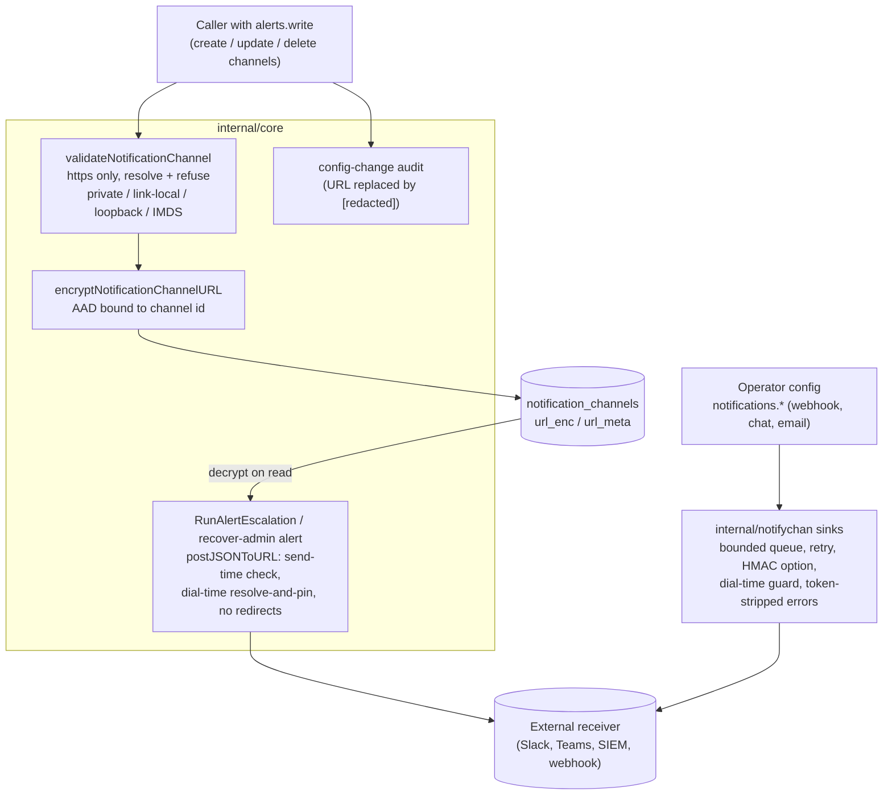

# Threat Model: Notifications and webhooks

> Part of [`docs/security/threat-models/`](README.md). Narrows
> [`../threat-model.md`](../threat-model.md) to the outbound alert path: the
> in-app notification fan-out (who is told), the config-managed external
> sinks (`internal/notifychan`: webhook, Slack/Teams chat, email) and the
> API-managed notification channels (`NotificationChannel`, used by alert
> escalation and the recover-admin alert). **The destination URL of a
> webhook, Slack or Teams channel is a bearer credential**: anyone who holds
> it can post into the receiving channel, and Slack-style URLs carry the
> token in the path. The destination is also a server-side request made on
> an operator's behalf, so it is the SSRF surface.
>
> Who is alerted about specific events is covered where the event lives
> ([break-glass.md](break-glass.md) BG-8, [sharing-and-acl.md](sharing-and-acl.md)).
>
> Evidence cells name a function or file and the test that proves it. A
> mitigation with no proving test on `main` is written as a **GAP**.
> `TestThreatModelEvidence_CitedFilesAndTestsExist` (`internal/threatmodelcheck`)
> checks that every cited path and `Test` / `Fuzz` function exists; it does
> not check that the test proves the mitigation.

## 1. System context

## 2. Trust boundaries

| Boundary | What crosses it | Enforcement |
|---|---|---|
| Channel administrator → server | A destination URL (bearer credential) and the events routed to it | `alerts.write` route gate; URL validation; encryption at rest; redacted audit |
| Server → external receiver | Alert text, secret names, severities; for config sinks, the notification title / message | https required; destination IP policy checked at creation, at send and at dial; redirects refused; optional HMAC signature (config sinks) |
| Database → server (channel row) | A URL read back from `url_enc` | Self-describing format tag; plaintext refused while encryption is on; AAD version required; AAD bound to the row |
| Notification content → audit / logs | The URL and delivery errors | Audit diff redaction; token-stripped errors in `notifychan` |

## 3. Threat table

| ID | STRIDE | Description | Mitigation | Evidence link | Residual risk / GAP |
|---|---|---|---|---|---|
| NW-1 | Information disclosure / tampering | **Channel URL at rest (#2433, fixed).** A database reader, a backup, or a DB-write attacker obtains, swaps or plants a channel URL; a planted plaintext URL redirects every alert and is then "laundered" into a valid envelope by the next backfill; ciphertext copied in from elsewhere is read back through the channel API. | The URL is stored only as `url_enc` / `url_meta`, encrypted with an AAD bound to the channel id (`ports.NotificationChannelURLAAD`); the `url` field is not a column. Reads fail closed: a plaintext-tagged row is refused while encryption is active, an encrypted row is refused when encryption is off, an envelope with no AAD version is refused (no decryption oracle), a ciphertext swapped between rows fails to decrypt, and one undecryptable row fails the whole list. The startup backfill refuses to finish while any plaintext row remains. Create inserts and encrypts in one transaction, so an encryption failure leaves no row. | `internal/core/notification_channels.go` `decryptNotificationChannelURL`, `encryptNotificationChannelURL`; `TestGetNotificationChannel_PlaintextTagRefusedWhenEncryptionActive`; `TestGetNotificationChannel_NonAADEnvelopeRefused`; `TestGetNotificationChannel_CrossRowCiphertextSwapRefused`; `TestGetNotificationChannel_EncryptedRowWithEncryptionOffFailsClosed`; `TestNotificationChannelURL_EncryptionOffThenOn`; `TestCreateNotificationChannel_EncryptFailurePersistsNoRow`; `TestMigrateNotificationChannelURLsToEncrypted_RefusesLeftoverPlaintextRow`; `TestMigrateNotificationChannelURLsToEncrypted_LeavesNoPlaintextOnSuccess`; `TestSweepNotificationChannels_NonAADEnvelopeRefused` | When no encryptor is configured the URL is stored as labelled plaintext (the disabled-encryption mode); this is the same posture as every other auth secret. Config-file sinks (`notifications.*`) keep their endpoint and token in the config file or environment, not in the database. |
| NW-2 | Information disclosure | **The API returns the URL.** The decrypted URL (the bearer credential) is included in the create, list and get responses of `/notification-channels`, so any caller with `alerts.write` can read every channel's credential, not just the ones they created. | The routes are gated on `alerts.write` (an alert administrator) and unauthenticated calls are refused. | `server/http/handlers/notification_channels.go` `channelToAPI`; `TestNotificationChannels_Unauthenticated` | **GAP TM2-GAP-7 (design decision).** Nothing masks the URL on read, and no test asserts it is masked; the handler comment calls the permission `system.write` while the router uses `alerts.write`. Options: return the URL only on create, then a redacted form (scheme and host) on read and list, with an explicit "replace URL" update. Until decided, treat `alerts.write` as holding every channel credential. |
| NW-3 | Spoofing / information disclosure | **SSRF.** A channel administrator points a webhook / Slack / Teams channel at the cloud metadata endpoint, an internal service or loopback; or a public name is re-pointed at a private address after the check (DNS rebinding); or the receiver redirects the POST to an internal host. | Three layers for API-managed channels: at create / update, https only and every resolved address must be public (a name that cannot be resolved is refused); at send, scheme and IP-literal re-check even when a caller injected its own HTTP client; at dial, `escalationTransport` resolves and pins the validated IP, including IPv4 embedded in NAT64 / IPv4-compatible addresses; the client refuses every redirect. Config-managed sinks apply the same idea (https unless loopback or an explicit opt-in, resolve-and-check, dial-time pin, no cross-host or https-to-http redirect). | `internal/core/notification_channels.go` `validateWebhookURL`; `internal/core/alert_escalation.go` `postJSONToURL`, `escalationTransport`; `TestValidateWebhookURL_RequiresHTTPS`; `TestValidateWebhookURL_RejectsPrivateIPs`; `TestRunAlertEscalation_DialTimeRefusesDNSRebind`; `FuzzSSRFGuardDifferential`; `TestNewWebhook_RejectsNonHTTPSEndpoint`; `TestNewWebhook_RejectsHostnameResolvingToPrivateIP`; `TestWebhookSink_DialTimeRefusesDNSRebind`; `TestRefuseRedirectDowngrade_CrossHostRejected` | **GAP TM2-GAP-9 (missing tests):** `noEscalationRedirect`, which makes the API-managed channel client refuse every redirect, has no test of its own (the config-sink redirect policy does); and the create-time refusal of a hostname that resolves to a private address, or does not resolve, is exercised only for IP-literal URLs (`TestValidateWebhookURL_RejectsPrivateIPs`). The config-managed sink permits loopback destinations by design (a development target), while API-managed channels refuse loopback; the two policies differ on purpose. Both can reach any public https host: there is no destination allowlist, so an alert administrator can send alert metadata (NW-6) to a host of their choice. |
| NW-4 | Repudiation / information disclosure | Channel configuration is changed to silence or redirect alerts, or the audit record of the change itself leaks the credential. | Create, update and delete each write a config-change audit event with before / after state, in which the URL (and the encrypted form) is replaced by `[redacted]`; a delete of an unknown id writes nothing; escalation-policy audit views carry a channel count, not channel ids. | `internal/core/notification_channels.go` `redactedNotificationChannelForAudit`; `TestCreateNotificationChannel_AuditsCreation`; `TestUpdateNotificationChannel_AuditsURLChange`; `TestDeleteNotificationChannel_AuditsDeletion`; `TestDeleteNotificationChannel_NotFound_NoAuditEvent` | None identified. `audit.read` is a narrower boundary than `alerts.write`, which is why the diff is redacted. |
| NW-5 | Information disclosure | **Token in logs.** A failed delivery logs the destination, and with it a path-embedded token. | Config-managed sinks strip the URL from transport errors before logging and log only scheme and host for the destination (`sanitizeDeliveryError`, `redactURLHost`). | `internal/notifychan/delivery.go` `sanitizeDeliveryError`; `TestSanitizeDeliveryError_StripsTokenFromTransportError`; `TestChatSink_DeliveryFailureLogDoesNotLeakWebhookToken`; `TestNewWebhook_InsecureSkipVerifyWarningRedactsEndpoint` | **GAP TM2-GAP-8 (real bug, reproduced on `main`).** The API-managed path does not do this. `postJSONToURL` builds its error from `url.URL.Redacted()`, which masks only a password in the userinfo; a Slack-style URL keeps its token in the path, so a failed POST returns `POST https://hooks.slack.com/services/T000/B000/<token>: unexpected status 500`, and `RunAlertEscalation` (and the recover-admin alert) write that error to the server log. Reproduced with a throwaway core test using an injected transport that returns 500. |
| NW-6 | Information disclosure | Alert content leaves the deployment: the receiver learns secret names, severities and descriptions, or user identifiers. | The escalation payload omits `accessed_by` and `ip_address` and scrubs any occurrence of either from the free-text description. Config-managed sinks carry the notification title, message and (best-effort) recipient email. | `internal/core/alert_escalation.go` `dispatchToChannel`, `redactAlertDescription`; `TestDispatchToChannel_WebhookPayload_NoPII`; `TestDispatchToChannel_WebhookRedactsPIIEmbeddedInDescription` | **Accepted:** the secret name and alert type are sent to the external receiver by design; a receiver you do not trust should not be a channel. Secret values are never part of an event. |
| NW-7 | Denial of service | A wedged or hostile receiver blocks the operation that raised the notification, or exhausts memory. | Delivery is asynchronous behind a bounded queue (a full queue drops and counts the event), with a 10 s request timeout, bounded retry with backoff for 5xx / 429 / transport errors only, and a capped drain of the response body. A notification failure never fails the triggering operation. | `internal/notifychan/webhook.go` `WebhookSink.Deliver`; `TestWebhookSink_DropsAndCountsWhenQueueFull`; `TestWebhookSink_RetriesTransientThenSucceeds`; `TestWebhookSink_PermanentErrorNotRetried` | **Delivery is best-effort and can be lost silently:** a full queue, a permanently failing receiver or a process stop drops the alert, visible only in the per-channel Prometheus counters. An alert is a detection aid, not a control (see BG-8 for the same stance on break-glass). |
| NW-8 | Spoofing | A third party posts forged alerts to the receiver, or replays a captured one. | Config-managed webhooks can sign the body with HMAC-SHA256 (`X-Keyorix-Signature: sha256=<hex>`) so the receiver can verify origin; an optional bearer token is sent in the `Authorization` header. | `internal/notifychan/webhook.go` `WebhookSink.send`; `TestWebhookSink_SignsPayloadWhenSecretSet`; `TestWebhookSink_DeliversJSONWithBearerAuth` | The signature covers the body only: there is no timestamp or nonce, so a captured, validly signed event can be replayed. API-managed channels are unsigned; the secrecy of the URL is their only authentication, which is why NW-1, NW-2 and NW-5 matter. |
| NW-9 | Information disclosure | An alert, token or payload travels in cleartext. | https is required unless the target is loopback or the operator sets the separate plaintext opt-in; the three trust decisions (self-signed certificate, private network, plaintext transport) are independent switches. | `internal/notifychan/secure_transport.go` `validateEndpoint`; `TestNewWebhook_RejectsNonHTTPSEndpoint`; `TestValidateWebhookURL_RequiresHTTPS` | `insecure_skip_verify` is an operator opt-in that logs a warning with the host only. |

## 4. Residual risks specific to this component

- **`alerts.write` is effectively "can read every channel credential"
  (NW-2, TM2-GAP-7)** until the read path masks the URL.
- **A failed API-managed delivery logs the bearer token (NW-5,
  TM2-GAP-8).** Until it is fixed, treat server logs as holding live
  channel credentials, or use config-managed sinks, which strip them.
- **No destination allowlist (NW-3, NW-6).** Which hosts receive alert
  metadata is the administrator's choice.
- **Alerts can be lost (NW-7)** and **replayed (NW-8)**.
- System-wide residuals are not re-derived; see
  [secret-storage-key-hierarchy.md](secret-storage-key-hierarchy.md) for the
  encryption envelope and [connectors.md](connectors.md) for the other
  outbound-egress guards.
